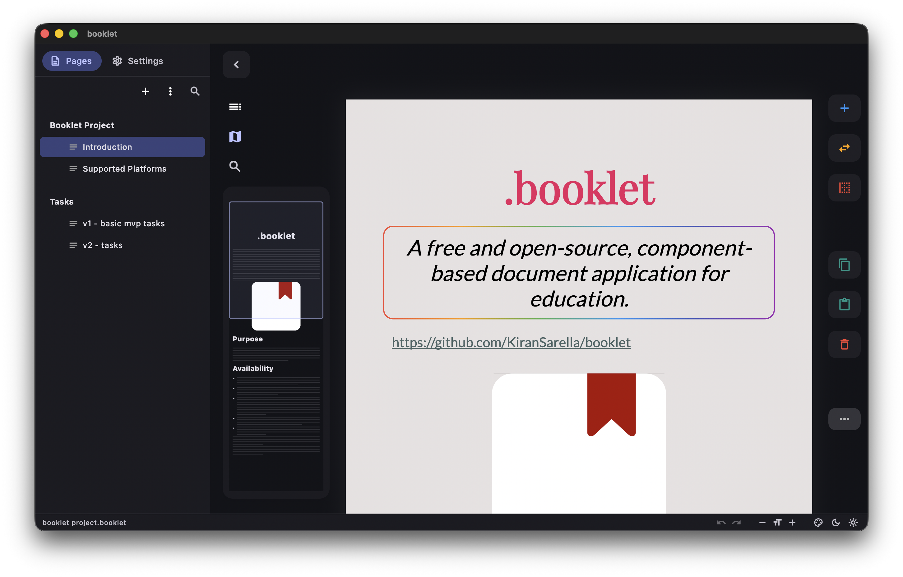
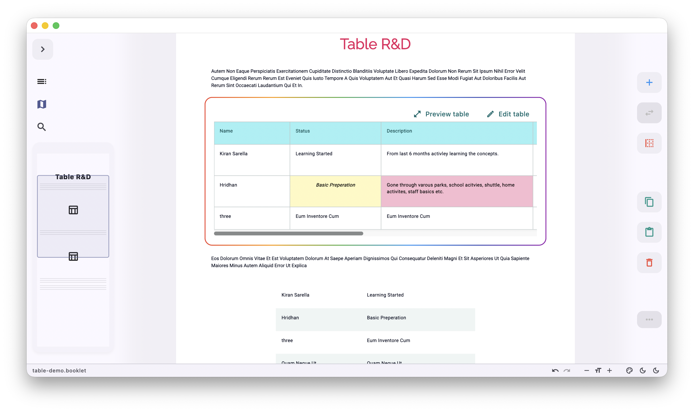
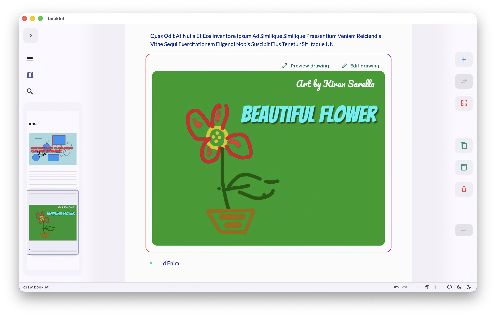
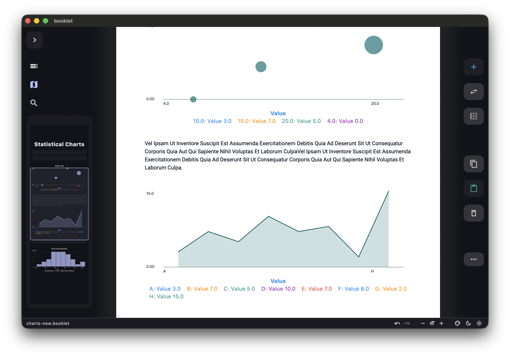
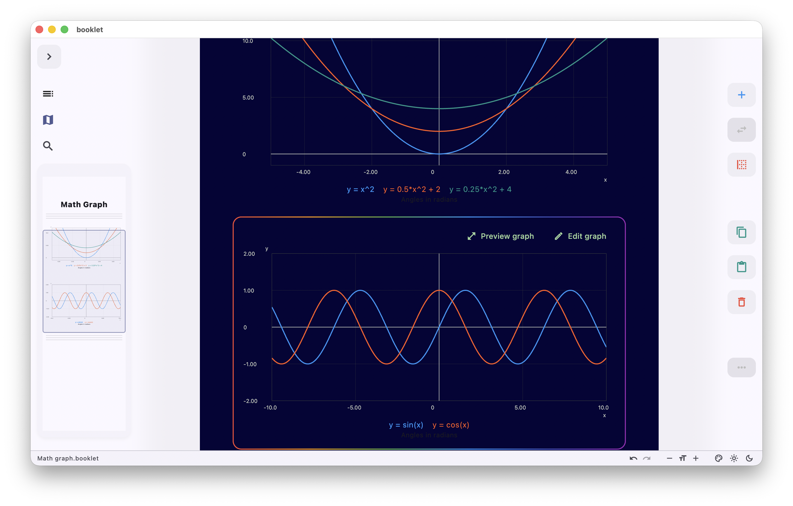

# .booklet

A free and open-source, component-based document application for education.


Version: 0.1

# Supported Platforms
Used flutter to make it platform independent.

Contributions are welcome.

**write mode**
- [X] linux desktop (tested)
- [X] mac desktop (tested)
- [ ] windows desktop

**read-only mode**
- [x] android tablet (testing)
- [ ] android mobile
- [ ] iOS tablet
- [ ] iOS mobiles
- [ ] web (published from desktop app)

# Screenshots












# Flutter

```
flutter run -d macos
flutter run -d chrome

flutter build macos


flutter clean
flutter pub get
flutter build macos --release


// Run on a connected Android tablet or emulator:

flutter devices
flutter run -d <android-device-id>


```


## License

This project is licensed under the GNU General Public License v3.0 (GPLv3) - see the [LICENSE](LICENSE) file for details.